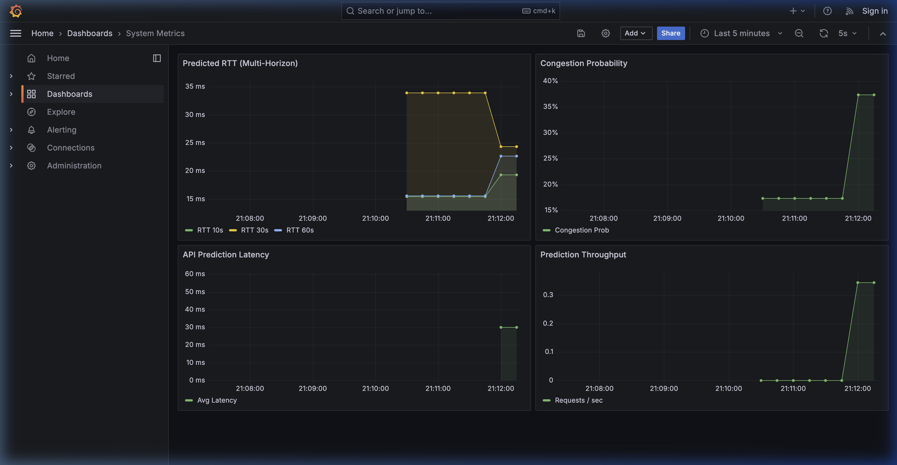
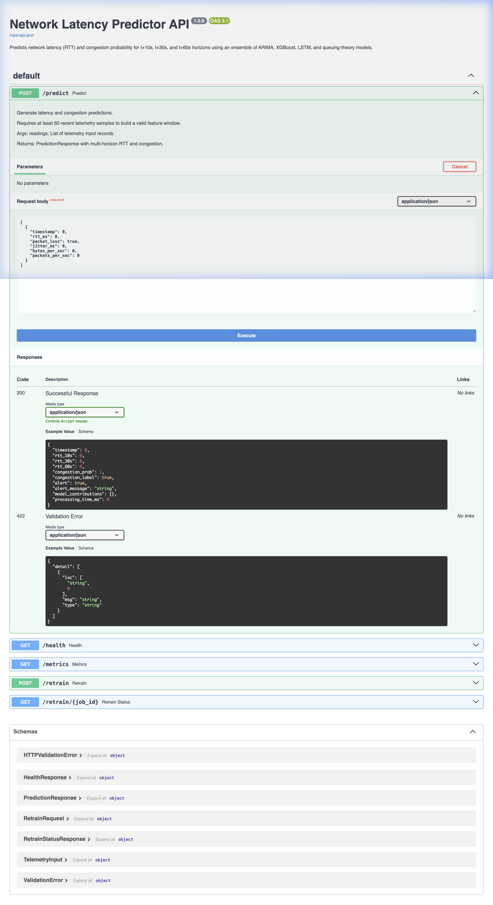
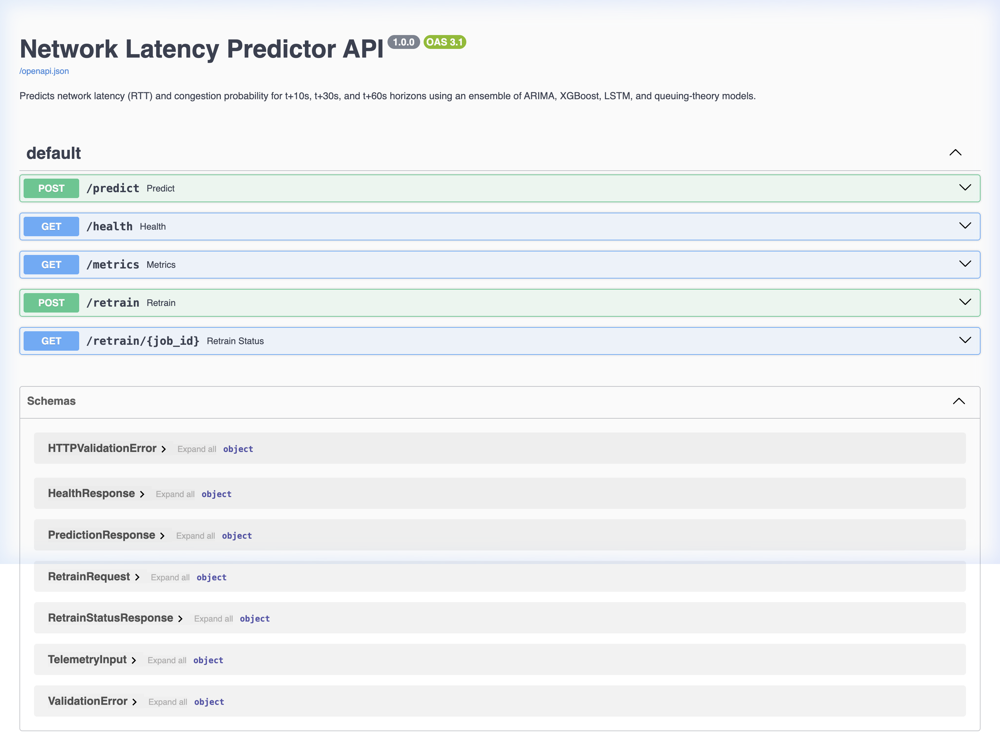
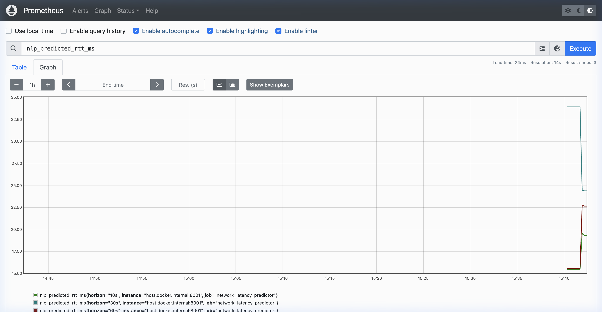
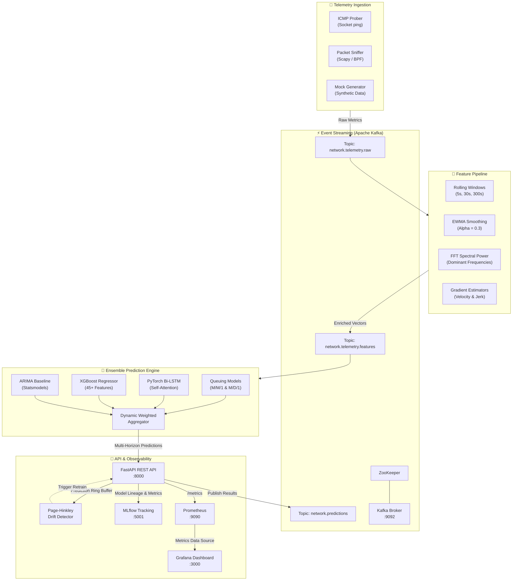

# ⚡ Network Latency Predictor

<div align="center">

[](https://www.python.org/)
[](https://fastapi.tiangolo.com/)
[](https://pytorch.org/)
[](https://xgboost.readthedocs.io/)
[](https://kafka.apache.org/)
[](https://grafana.com/)
[](https://www.docker.com/)
[](file:///network_latency_predictor/tests)
[](https://opensource.org/licenses/MIT)

<p align="center">
  <strong>Production-ready, multi-horizon network round-trip time (RTT) forecasting and proactive congestion prevention using a real-time ensemble of ARIMA, XGBoost, PyTorch Bi-LSTM, and Queuing Theory.</strong>
</p>

[Explore Features](#-key-features) • [View Architecture](#-architecture--data-flow) • [Quickstart Guide](#-quickstart-guide) • [API Reference](#-api-reference) • [Grafana Dashboard](#-grafana--monitoring-setup)

</div>

---

## 📑 Table of Contents

- [The Problem & Product Overview](#-the-problem--product-overview)
- [Application Preview & Screenshots](#-application-preview--screenshots)
- [Key Features](#-key-features)
- [Architecture & Data Flow](#-architecture--data-flow)
- [The 4-Model Ensemble Deep Dive](#-the-4-model-ensemble-deep-dive)
- [Technology Stack](#-technology-stack)
- [Quickstart Guide](#-quickstart-guide)
  - [1. Prerequisites](#1-prerequisites)
  - [2. Clone & Environment Setup](#2-clone--environment-setup)
  - [3. Generate Synthetic Telemetry](#3-generate-synthetic-telemetry)
  - [4. Model Training (Local or Google Colab)](#4-model-training-local-or-google-colab)
  - [5. Launch Full Stack (Docker Compose)](#5-launch-full-stack-docker-compose)
  - [6. Verification & Health Check](#6-verification--health-check)
- [Interactive API Reference](#-interactive-api-reference)
  - [POST /predict](#post-predict)
  - [GET /health](#get-health)
  - [GET /metrics](#get-metrics)
  - [POST /retrain & GET /retrain/{job_id}](#post-retrain--get-retrainjob_id)
- [Grafana & Monitoring Setup](#-grafana--monitoring-setup)
- [Project Directory Structure](#-project-directory-structure)
- [Configuration & Environment Variables](#-configuration--environment-variables)
- [Testing & Quality Assurance](#-testing--quality-assurance)
- [Future Roadmap](#-future-roadmap)
- [Contributing & License](#-contributing--license)

---

## 🌐 The Problem & Product Overview

### The Challenge with Reactive Monitoring
Traditional Network Performance Monitoring (NPM) systems alert network operators **after** latency spikes, packet loss occurs, or customer-facing SLOs are breached. By the time reactive threshold alerts fire:
* Real-time VoIP, video conferencing, financial order routing, and gaming sessions experience degraded quality or dropped connections.
* Adaptive bitrate algorithms downgrade stream quality unnecessarily.
* Load balancers make routing decisions based on past, stale state rather than impending link congestion.

### The Solution: Network Latency Predictor
**Network Latency Predictor** shifts network operations from **reactive alerting** to **proactive anticipation**. By combining raw telemetry ingestion (ICMP probes and BPF packet sniffing) with streaming feature engineering and a dynamically weighted ensemble of 4 distinct analytical and machine learning models, the system predicts:
1. **Multi-Horizon Round Trip Time (RTT):** Forecasted network latency at **t+10s**, **t+30s**, and **t+60s**.
2. **Congestion Probability & Early Alerting:** Continuous probabilistic score (`0.0`–`1.0`) indicating the likelihood of link saturation within the next minute.
3. **Model Interpretability:** Real-time breakdown of per-model contributions (`arima`, `xgboost`, `lstm`, `queuing`), providing transparent inference for automated traffic shapers and SREs.

---

## 📸 Application Preview & Screenshots

<div align="center">

### 📊 Real-Time Grafana Telemetry Dashboard
*Live multi-horizon RTT forecasting ($t+10s, t+30s, t+60s$), congestion probability gauge, API inference latency, and prediction throughput provisioned via Prometheus.*



</div>

<br />

<table>
  <tr>
    <td width="50%">
      <div align="center">
        <strong>⚡ Interactive Swagger UI (`/docs`)</strong>
        <br />
        <sub>Explore and test live REST API endpoints with auto-generated schemas</sub>
      </div>
      <br />
      
    </td>
    <td width="50%">
      <div align="center">
        <strong>🔍 Real-Time Model Inference Testing (`/predict`)</strong>
        <br />
        <sub>Live execution showing 200 OK multi-horizon RTT & ensemble weights</sub>
      </div>
      <br />
      
    </td>
  </tr>
  <tr>
    <td width="50%">
      <div align="center">
        <strong>📈 Real-Time Prometheus Metrics Stream (`:9090`)</strong>
        <br />
        <sub>Live scraped telemetry time-series (`nlp_predicted_rtt_ms`, gauges, histograms)</sub>
      </div>
      <br />
      
    </td>
    <td width="50%">
      <div align="center">
        <strong>📖 ReDoc OpenAPI Specification (`/redoc`)</strong>
        <br />
        <sub>Standardized, clean API reference for seamless developer integration</sub>
      </div>
      <br />
      
    </td>
  </tr>
</table>

---

## 🚀 Key Features

- **⏱️ Multi-Horizon Latency Forecasting:** Predicts RTT at $t+10s$, $t+30s$, and $t+60s$ into the future, enabling proactive traffic re-routing and buffer sizing.
- **🚨 Proactive Congestion Early Warning:** Generates an automated alert when congestion probability exceeds 80%, specifying anticipated spike severity before packet loss occurs.
- **🧠 4-Model Hybrid Ensemble:** Integrates linear statistical baselines (ARIMA), tree-based gradient boosting (XGBoost), deep recurrent neural networks (PyTorch LSTM), and first-principles queueing models (M/M/1 & M/D/1).
- **🔬 Advanced 45-Feature Streaming Pipeline:** Extracts rolling window statistics (5s, 30s, 300s), Exponentially Weighted Moving Averages (EWMA), gradient velocities, and Fast Fourier Transform (FFT) spectral power.
- **📡 Dual Telemetry Ingestion Engine:** Automated continuous ICMP socket prober paired with raw BPF packet sniffing (`Scapy`/`PyShark`) for live traffic telemetry.
- **🔄 Event Streaming via Apache Kafka:** Real-time stream processing with dedicated topics for raw telemetry (`network.telemetry.raw`), engineered features (`network.telemetry.features`), and prediction outputs (`network.predictions`).
- **📉 Concept Drift Detection (Page-Hinkley):** Evaluates rolling Mean Absolute Error (MAE) and triggers automated retraining workflows when distribution shifts exceed threshold tolerances.
- **📊 Turnkey Observability:** Pre-configured Prometheus scraping and auto-provisioned Grafana dashboards tracking multi-horizon RTT, model MAE, and inference latency.
- **🛡️ Production-Grade API Design:** Sub-30ms inference times, RFC 7807 structured error responses (never raw 500s), CORS enabled, and background worker lifecycle management.

---

## 🏗️ Architecture & Data Flow



### Data Flow Lifecycle

1. **Ingestion:** Telemetry probes monitor network targets (e.g. `8.8.8.8`, `1.1.1.1`) every second, recording timestamp, RTT, jitter, packet loss, byte rate, and packet throughput.
2. **Feature Extraction:** A sliding historical window transforms raw metrics into ~45 statistical, temporal, and frequency-domain features.
3. **Inference:** The feature vector is passed simultaneously to the 4 ensemble components.
4. **Weighted Aggregation:** Outputs are normalized and blended based on validated weights:
   $$\text{RTT}_{\text{ensemble}} = w_{\text{arima}}\hat{y}_{\text{arima}} + w_{\text{xgb}}\hat{y}_{\text{xgb}} + w_{\text{lstm}}\hat{y}_{\text{lstm}} + w_{\text{queue}}\hat{y}_{\text{queue}}$$
5. **Monitoring & Drift Tracking:** Prometheus records inference time and prediction values. The Page-Hinkley test evaluates residuals to identify telemetry drift.

---

## 🧠 The 4-Model Ensemble Deep Dive

| Model | Underlying Framework | Primary Strength | Horizon Focus | Default Weight |
|---|---|---|---|:---:|
| **ARIMA** | `statsmodels` | Linear autoregressive baseline, handles stationary drift | Short ($t+10s$) | `0.20` |
| **XGBoost** | `xgboost` | Non-linear feature interactions across 45 rolling & FFT features | Medium / Long ($t+30s, t+60s$) | `0.40` |
| **Bi-LSTM** | `torch.nn` (PyTorch) | Captures deep sequential temporal dynamics & self-attention | Multi-Horizon ($10s, 30s, 60s$) | `0.30` |
| **Queuing Theory** | Analytical ($M/M/1, M/D/1$) | Physics-based network link modeling from utilization $\rho = \frac{\lambda}{\mu}$ | Extreme Load Asymptotes | `0.10` |

### 1. ARIMA (Autoregressive Integrated Moving Average)
Provides a solid time-series baseline. Fitted on recent univariate RTT history to model underlying trends and mean-reverting behavior without overfitting to transient packet spikes.

### 2. XGBoost Regressor & Classifier
Trained on 45 engineered features across 3 rolling time windows (5s, 30s, 300s):
- Rolling statistics: mean, standard deviation, min, max, skewness, kurtosis.
- EWMA smoothed signals and EWMA rate of change.
- Fast Fourier Transform (FFT) dominant frequencies and spectral energy to identify periodic traffic patterns.
- Velocity and acceleration gradients of latency growth.

### 3. PyTorch Bidirectional LSTM with Attention
A custom deep architecture featuring:
- Bidirectional LSTM layers processing sequential telemetry windows.
- Self-attention mechanism learning dynamic temporal importance across time steps.
- Dual output heads: Multi-horizon regression head ($t+10s, t+30s, t+60s$) and a binary classification head with sigmoid activation for congestion probability.

### 4. Queuing-Theory Analytical Models ($M/M/1$ & $M/D/1$)
Uses first-principles analytical queuing equations:
$$W_q^{(M/M/1)} = \frac{\rho}{\mu(1 - \rho)}, \quad W_q^{(M/D/1)} = \frac{\rho}{2\mu(1 - \rho)}$$
where $\rho$ represents channel utilization. When utilization nears $1.0$, queuing delay asymptotically increases, grounding machine learning predictions in physical network constraints.

---

## 💻 Technology Stack

<div align="center">

| Domain | Technologies & Libraries |
|---|---|
| **Machine Learning & AI** | `PyTorch 2.3.0`, `XGBoost 2.0.3`, `Statsmodels 0.14.2`, `Scikit-Learn 1.4.2`, `SciPy 1.13.0`, `SHAP 0.45.0` |
| **Backend & Serving** | `FastAPI 0.111.0`, `Uvicorn 0.29.0`, `Pydantic v2 (2.7.1)`, `Loguru 0.7.2`, `Python-Dotenv` |
| **Streaming & Telemetry** | `Apache Kafka 7.6.0`, `Kafka-Python 2.0.2`, `Scapy 2.5.0`, `PyShark 0.6`, Raw ICMP Sockets |
| **Monitoring & Experimentation**| `Prometheus 2.52.0`, `Grafana 10.4.2`, `MLflow 2.13.0`, `prometheus-client 0.20.0` |
| **DevOps & Infrastructure** | `Docker`, `Docker Compose v2`, `ZooKeeper 7.6.0`, `Alpine Linux` |
| **Testing & Quality** | `Pytest 8.2.0`, `pytest-asyncio 0.23.7`, `HTTPX 0.27.0` |

</div>

---

## ⚡ Quickstart Guide

### 1. Prerequisites

- **Python:** `3.9` through `3.11`
- **Docker & Docker Compose:** Latest version installed and running
- **Git**

### 2. Clone & Environment Setup

```bash
git clone https://github.com/sparsh-sharma-08/Network-Latency-Predictor.git
cd Network-Latency-Predictor/network_latency_predictor

# Create and activate a virtual environment
python3 -m venv venv
source venv/bin/activate

# Install dependencies
pip install -r requirements.txt

# Copy example environment configuration
cp .env.example .env
```

### 3. Generate Synthetic Telemetry

The project includes a generator simulating realistic network conditions (baseline latency, diurnal traffic cycles, jitter, packet loss bursts, and queuing spikes):

```bash
python scripts/generate_mock_data.py --days 30 --seed 42 --output data/mock_telemetry.csv
```

### 4. Model Training (Local or Google Colab)

#### Option A: Train Locally

Train all 4 models and save artifacts to `models/saved/`:

```bash
python scripts/train_initial_models.py --data data/mock_telemetry.csv --model-dir models/saved/
```

#### Option B: Train on Google Colab (Recommended for GPU Acceleration)

1. Open [`notebooks/train_on_colab.ipynb`](notebooks/train_on_colab.ipynb) in [Google Colab](https://colab.research.google.com/).
2. Select **Runtime → Change runtime type → T4 GPU**.
3. Run all cells — the notebook generates training data, trains ARIMA, XGBoost, LSTM, and Queuing models, logs to MLflow, and exports a zip bundle (`trained_models_*.zip`).
4. Import the trained models locally:
   ```bash
   python scripts/sync_models.py --import-zip trained_models_YYYYMMDD_HHMMSS.zip
   ```
5. Verify model bundle integrity:
   ```bash
   python scripts/sync_models.py --verify
   ```

### 5. Launch Full Stack (Docker Compose)

Spin up the entire distributed cluster (ZooKeeper, Kafka, MLflow, Collector, FastAPI API, Prometheus, and Grafana) with a single command:

```bash
docker-compose -f docker/docker-compose.yml up -d
```

### 6. Verification & Health Check

Verify all microservices are healthy:

```bash
# Check REST API health and model status
curl http://localhost:8000/health

# Output:
# {"status":"ok","model_loaded":true,"kafka_connected":true,"last_prediction_ts":null,"uptime_sec":15.2}
```

Now access the web interfaces:
- **FastAPI Interactive Docs:** [http://localhost:8000/docs](http://localhost:8000/docs)
- **FastAPI ReDoc Spec:** [http://localhost:8000/redoc](http://localhost:8000/redoc)
- **Grafana Dashboard:** [http://localhost:3000](http://localhost:3000) *(User: `admin`, Password: from `.env` or `admin`)*
- **Prometheus UI:** [http://localhost:9090](http://localhost:9090)
- **MLflow Tracking Server:** [http://localhost:5001](http://localhost:5001)

To gracefully stop all containers:
```bash
docker-compose -f docker/docker-compose.yml down
```

---

## 🔌 Interactive API Reference

The FastAPI service exposes high-performance asynchronous endpoints conforming to RFC 7807 for error handling.

| Method | Endpoint | Description |
|---|---|---|
| `GET` | `/health` | Service health status, model loaded flag, Kafka connectivity, and uptime |
| `POST` | `/predict` | Multi-horizon RTT predictions and congestion probability score |
| `GET` | `/metrics` | Prometheus metrics exposition format |
| `POST` | `/retrain` | Trigger asynchronous background model retraining job |
| `GET` | `/retrain/{job_id}` | Check status and metrics of a model retraining job |
| `GET` | `/docs` | OpenAPI Swagger UI interactive explorer |
| `GET` | `/redoc` | Standalone ReDoc technical API documentation |

---

### `POST /predict`

Generate multi-horizon latency predictions and congestion probabilities. Requires a minimum window of 60 recent telemetry samples (up to 350 for full long-window feature calculations).

#### Sample Request

```bash
curl -X POST http://localhost:8000/predict \
  -H "Content-Type: application/json" \
  -d @payload.json
```

Or using inline JSON:

```json
[
  {
    "timestamp": 1700000000.0,
    "rtt_ms": 18.5,
    "jitter_ms": 1.4,
    "packet_loss": 0.0,
    "bytes_per_sec": 45000,
    "packets_per_sec": 320
  },
  "... (60+ consecutive 1-second records)"
]
```

#### Sample Response (`200 OK`)

```json
{
  "timestamp": 1792337632.185,
  "rtt_10s": 15.426,
  "rtt_30s": 33.903,
  "rtt_60s": 15.565,
  "congestion_prob": 0.1732,
  "congestion_label": false,
  "alert": false,
  "alert_message": null,
  "model_contributions": {
    "arima": {
      "weight": 0.2,
      "rtt_10s": 24.076,
      "rtt_30s": 24.076,
      "rtt_60s": 24.076,
      "congestion_prob": 0.0
    },
    "xgboost": {
      "weight": 0.4,
      "rtt_10s": 10.037,
      "rtt_30s": 56.154,
      "rtt_60s": 10.233,
      "congestion_prob": 0.415
    },
    "lstm": {
      "weight": 0.3,
      "rtt_10s": 20.0,
      "rtt_30s": 20.0,
      "rtt_60s": 20.0,
      "congestion_prob": 0.0
    },
    "queuing": {
      "weight": 0.1,
      "rtt_10s": 5.964,
      "rtt_30s": 6.262,
      "rtt_60s": 6.56,
      "congestion_prob": 0.0718
    }
  },
  "processing_time_ms": 22.45
}
```

---

### `GET /health`

```bash
curl http://localhost:8000/health
```

```json
{
  "status": "ok",
  "model_loaded": true,
  "kafka_connected": true,
  "last_prediction_ts": 1792337632.185,
  "uptime_sec": 342.1
}
```

---

### `GET /metrics`

Returns standard Prometheus exposition metrics ready for scraper consumption:

```bash
curl http://localhost:8000/metrics
```

```text
# HELP nlp_predictions_total Total number of predictions served
# TYPE nlp_predictions_total counter
nlp_predictions_total 25.0

# HELP nlp_predicted_rtt_ms Most recent predicted RTT in milliseconds
# TYPE nlp_predicted_rtt_ms gauge
nlp_predicted_rtt_ms{horizon="10s"} 15.426
nlp_predicted_rtt_ms{horizon="30s"} 33.903
nlp_predicted_rtt_ms{horizon="60s"} 15.565

# HELP nlp_congestion_probability Most recent congestion probability prediction
# TYPE nlp_congestion_probability gauge
nlp_congestion_probability 0.1732

# HELP nlp_prediction_latency_seconds Time taken to serve a prediction request
# TYPE nlp_prediction_latency_seconds histogram
nlp_prediction_latency_seconds_count 25.0
nlp_prediction_latency_seconds_sum 0.541
```

---

### `POST /retrain` & `GET /retrain/{job_id}`

Trigger an asynchronous model update using historical operational data:

```bash
curl -X POST http://localhost:8000/retrain \
  -H "Content-Type: application/json" \
  -d '{"days_of_history": 14}'
```

```json
{
  "job_id": "8d39f4e2-63bc-42b7-a365-8b248a39e941",
  "status": "queued",
  "message": "Retrain job queued with 14 days of history"
}
```

Check job execution status:
```bash
curl http://localhost:8000/retrain/8d39f4e2-63bc-42b7-a365-8b248a39e941
```

---

## 📊 Grafana & Monitoring Setup

1. Launch Docker Compose or navigate to `http://localhost:3000`.
2. Login with credentials:
   - **Username:** `admin`
   - **Password:** configured in `.env` under `GRAFANA_ADMIN_PASSWORD` (defaults to `admin`).
3. The **Prometheus data source** (`http://prometheus:9090`) and the **System Metrics Dashboard** are **automatically provisioned** on startup from `docker/grafana_dashboards/` and `docker/grafana_datasources/`.
4. Pre-configured dashboard panels:
   - **Predicted RTT (Multi-Horizon):** Real-time overlay of `nlp_predicted_rtt_ms{horizon="10s"}`, `30s`, and `60s`.
   - **Congestion Probability Gauge:** Visual threshold meter highlighting normal ($<50\%$), elevated ($50\%-80\%$), and critical alert ($>80\%$) states.
   - **API Prediction Latency:** P50, P90, and P99 API service times from `nlp_prediction_latency_seconds`.
   - **Prediction Throughput:** Request rate per second calculated from `rate(nlp_predictions_total[1m])`.
   - **Model Drift Score:** Continuous Page-Hinkley cumulative residual score (`nlp_drift_score`).

---

## 📁 Project Directory Structure

```text
network_latency_predictor/
├── api/                             # FastAPI application & endpoints
│   ├── kafka_consumer.py            # Async background Kafka stream consumer
│   ├── main.py                      # Application lifespan, CORS, and routing
│   ├── routes.py                    # /predict, /health, /metrics, /retrain
│   └── schemas.py                   # Pydantic v2 validation models & responses
├── collector/                       # Telemetry ingestion engines
│   ├── icmp_prober.py               # Raw ICMP ping prober
│   ├── kafka_producer.py            # Telemetry publisher to Kafka
│   ├── main.py                      # Continuous background probe loop
│   ├── mock_generator.py            # Synthetic telemetry data simulator
│   └── packet_sniffer.py            # BPF packet sniffer via Scapy / PyShark
├── config/                          # Centralized settings & logging
│   ├── logging_config.py            # Loguru structured logging configuration
│   └── settings.py                  # Pydantic BaseSettings loading from .env
├── data/                            # Datasets & synthetic telemetry CSVs
│   └── mock_telemetry.csv           # 30-day baseline synthetic dataset
├── docker/                          # Containerization & orchestration
│   ├── Dockerfile.api               # Optimized container for FastAPI
│   ├── Dockerfile.collector         # Ingestion container with NET_RAW capability
│   ├── docker-compose.yml           # 7-service full stack cluster
│   ├── grafana_dashboards/          # Auto-provisioned Grafana dashboards
│   ├── grafana_datasources/         # Auto-provisioned Prometheus data source
│   ├── mlflow_data/                 # Persistent SQLite & artifact MLflow store
│   └── prometheus.yml               # Prometheus scrape targets configuration
├── features/                        # Advanced streaming feature engineering
│   ├── ewma.py                      # Exponentially weighted moving averages
│   ├── fft_features.py              # Spectral energy & dominant frequencies
│   ├── gradient_estimator.py        # Latency velocity & onset gradients
│   ├── pipeline.py                  # Orchestrator transforming 350-sample sliding windows
│   └── rolling_stats.py             # Multi-window rolling statistics (5s, 30s, 300s)
├── models/                          # Core analytical & machine learning models
│   ├── arima_model.py               # Statsmodels ARIMA univariate baseline
│   ├── base_model.py                # Abstract BaseLatencyModel interface
│   ├── ensemble.py                  # Weighted dynamic ensemble aggregator
│   ├── lstm_model.py                # PyTorch Bi-LSTM with self-attention
│   ├── queuing_model.py             # M/M/1 & M/D/1 analytical queuing model
│   ├── saved/                       # Serialized model weights (*.pkl, *.json)
│   └── xgboost_model.py             # Gradient boosted regressor & classifier
├── monitoring/                      # Telemetry exporters & drift tracking
│   ├── drift_detector.py            # Page-Hinkley concept drift algorithm
│   └── prometheus_exporter.py       # Custom Prometheus metric declarations
├── notebooks/                       # Research & cloud training workflows
│   ├── generate_notebook.py         # Automated Colab notebook generator
│   └── train_on_colab.ipynb         # End-to-end T4 GPU Colab training notebook
├── scripts/                         # CLI automation scripts
│   ├── generate_mock_data.py        # Synthetic dataset generator CLI
│   ├── sync_models.py               # Colab-to-local ZIP sync & verification
│   └── train_initial_models.py      # Local model training CLI
├── tests/                           # Complete test suite (30 passing tests)
│   ├── test_api.py                  # API endpoints, status codes, and schema validation
│   ├── test_collector.py            # Ingestion shape, timestamps, and column tests
│   ├── test_features.py             # EWMA, FFT, rolling stats, and gradient tests
│   └── test_models.py               # Overfit tests, shapes, and ensemble weighting
├── payload.json                     # Valid 350-sample telemetry test payload
├── requirements.txt                 # Pinned dependencies
├── .env.example                     # Environment variables template
└── README.md                        # Documentation
```

---

## ⚙️ Configuration & Environment Variables

All parameters are configured via `.env` or system environment variables:

| Variable | Default Value | Description |
|---|---|---|
| `NETWORK_INTERFACE` | `eth0` | Network interface for raw packet capture |
| `PROBE_HOSTS` | `["8.8.8.8","1.1.1.1","208.67.222.222"]` | ICMP probe destination targets |
| `PROBE_INTERVAL_SEC` | `1.0` | Probing frequency in seconds |
| `CAPTURE_FILTER` | `icmp or tcp` | Berkeley Packet Filter (BPF) capture expression |
| `KAFKA_BOOTSTRAP_SERVERS` | `localhost:9092` | Kafka broker host & port |
| `KAFKA_TOPIC_RAW` | `network.telemetry.raw` | Topic for raw telemetry readings |
| `KAFKA_TOPIC_FEATURES` | `network.telemetry.features` | Topic for 45-dimension feature vectors |
| `KAFKA_TOPIC_PREDICTIONS` | `network.predictions` | Topic for output prediction events |
| `WINDOW_SHORT` | `5` | Short rolling feature window (seconds) |
| `WINDOW_MEDIUM` | `30` | Medium rolling feature window (seconds) |
| `WINDOW_LONG` | `300` | Long rolling feature window (seconds) |
| `EWMA_ALPHA` | `0.3` | Exponential smoothing weight factor |
| `MODEL_DIR` | `./models/saved` | Directory containing serialized model artifacts |
| `ENSEMBLE_WEIGHTS` | `{"arima":0.2,"xgboost":0.4,"lstm":0.3,"queuing":0.1}` | Normalized model weights in JSON |
| `API_HOST` | `0.0.0.0` | FastAPI network bind host |
| `API_PORT` | `8000` | FastAPI network bind port |
| `MLFLOW_TRACKING_URI` | `http://localhost:5000` | MLflow tracking server URI |
| `MLFLOW_EXPERIMENT_NAME` | `network_latency_prediction` | Active MLflow experiment name |
| `DRIFT_THRESHOLD_MAE` | `5.0` | Residual MAE threshold triggering drift alert (ms) |
| `DRIFT_WINDOW_SIZE` | `500` | Ring buffer size for drift evaluation |
| `GRAFANA_ADMIN_PASSWORD` | `admin` | Initial admin password for Grafana |

---

## 🧪 Testing & Quality Assurance

The codebase includes an extensive, fully automated test suite containing 30 unit and integration tests covering all critical components:

```bash
# Run the full test suite with verbose reporting
python3 -m pytest tests/ -v
```

### Test Suite Coverage Breakdown

```text
============================= test session starts ==============================
tests/test_api.py::test_health_endpoint PASSED                           [  3%]
tests/test_api.py::test_predict_returns_valid_schema PASSED              [  6%]
tests/test_api.py::test_predict_requires_min_60_samples PASSED           [ 10%]
tests/test_api.py::test_metrics_endpoint PASSED                          [ 13%]
tests/test_collector.py::TestMockGenerator::test_mock_generator_shape PASSED [ 16%]
tests/test_collector.py::TestMockGenerator::test_mock_required_columns PASSED [ 20%]
tests/test_collector.py::TestMockGenerator::test_mock_congestion_labels_present PASSED [ 23%]
tests/test_collector.py::TestMockGenerator::test_mock_rtt_positive PASSED [ 26%]
tests/test_collector.py::TestMockGenerator::test_mock_timestamps_increasing PASSED [ 30%]
tests/test_collector.py::TestMockGenerator::test_mock_reproducible PASSED [ 33%]
tests/test_features.py::TestRollingStats::test_rolling_stats_correctness PASSED [ 36%]
tests/test_features.py::TestRollingStats::test_rolling_stats_keys PASSED [ 40%]
tests/test_features.py::TestRollingStats::test_rolling_stats_length PASSED [ 43%]
tests/test_features.py::TestEWMA::test_ewma_convergence PASSED           [ 46%]
tests/test_features.py::TestEWMA::test_ewma_std_constant PASSED          [ 50%]
tests/test_features.py::TestEWMA::test_ewma_gradient_constant PASSED     [ 53%]
tests/test_features.py::TestFFTFeatures::test_fft_sine_wave PASSED       [ 56%]
tests/test_features.py::TestFFTFeatures::test_fft_returns_scalars PASSED [ 60%]
tests/test_features.py::TestFFTFeatures::test_fft_short_series PASSED    [ 63%]
tests/test_features.py::TestGradientEstimator::test_gradient_rising_trend PASSED [ 66%]
tests/test_features.py::TestGradientEstimator::test_gradient_constant PASSED [ 70%]
tests/test_features.py::TestGradientEstimator::test_congestion_onset_score_range PASSED [ 73%]
tests/test_models.py::TestQueuingModel::test_queuing_model_mm1 PASSED    [ 76%]
tests/test_models.py::TestQueuingModel::test_queuing_utilization_clipped PASSED [ 80%]
tests/test_models.py::TestQueuingModel::test_queuing_model_fit PASSED    [ 83%]
tests/test_models.py::TestXGBoostModel::test_xgboost_overfit_small PASSED [ 86%]
tests/test_models.py::TestXGBoostModel::test_xgboost_output_shape PASSED [ 90%]
tests/test_models.py::TestEnsemble::test_ensemble_weights_sum_to_one PASSED [ 93%]
tests/test_models.py::TestEnsemble::test_ensemble_predict_with_single_model PASSED [ 96%]
tests/test_models.py::TestLSTMModel::test_lstm_output_shape PASSED       [100%]
======================== 30 passed in 4.28s ====================================
```

---

## 🗺️ Future Roadmap

- [x] **Core Ensemble Architecture:** ARIMA, XGBoost, PyTorch LSTM, and M/M/1 queuing models.
- [x] **Streaming Feature Pipeline:** Rolling windows (5s/30s/300s), EWMA smoothing, gradient velocity, and FFT spectral extraction.
- [x] **Turnkey Monitoring Stack:** Automated Prometheus metric exporter and provisioned Grafana dashboards.
- [x] **Google Colab Cloud Training:** GPU acceleration and model synchronization utilities.
- [x] **Continuous Concept Drift Tracking:** Page-Hinkley cumulative residual monitoring.
- [ ] **Temporal Fusion Transformers (TFT):** Next-generation attention architecture for multi-quantile prediction intervals ($P10, P50, P90$).
- [ ] **eBPF-Based Telemetry Ingestion:** Kernel-space low-overhead TCP RTT tracking (`bcc` / `libbpf`) bypassing userspace socket overhead.
- [ ] **Dynamic Auto-Weight Tuning:** Online Reinforcement Learning (Bandit algorithms) adapting ensemble weights $\mathbf{w}_t$ based on rolling real-time loss.
- [ ] **Kubernetes Helm Charts:** Cloud-native deployment manifests with horizontal pod autoscaling (HPA) based on inference queue depth.

---

## 🤝 Contributing

Contributions from network engineers, data scientists, and systems developers are welcome!

1. Fork the repository (`https://github.com/sparsh-sharma-08/Network-Latency-Predictor`).
2. Create your feature branch (`git checkout -b feature/amazing-feature`).
3. Commit your changes (`git commit -m 'Add new feature'`).
4. Ensure all tests pass (`python3 -m pytest tests/ -v`).
5. Push to the branch (`git push origin feature/amazing-feature`).
6. Open a Pull Request.

---

## 📄 License & Acknowledgements

This project is licensed under the **MIT License** — see the [LICENSE](LICENSE) file for full details.

### Acknowledgements
- [FastAPI](https://fastapi.tiangolo.com/) for the lightning-fast modern Python web framework.
- [PyTorch](https://pytorch.org/) & [XGBoost](https://xgboost.readthedocs.io/) for high-performance ML inference.
- [Prometheus](https://prometheus.io/) & [Grafana](https://grafana.com/) for industry-standard observability.
- [Confluent](https://www.confluent.io/) for Apache Kafka container distributions.
